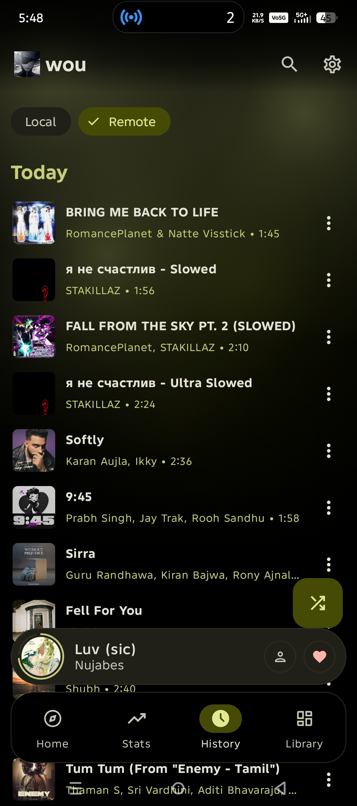
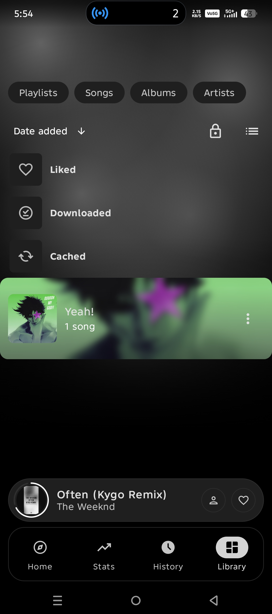
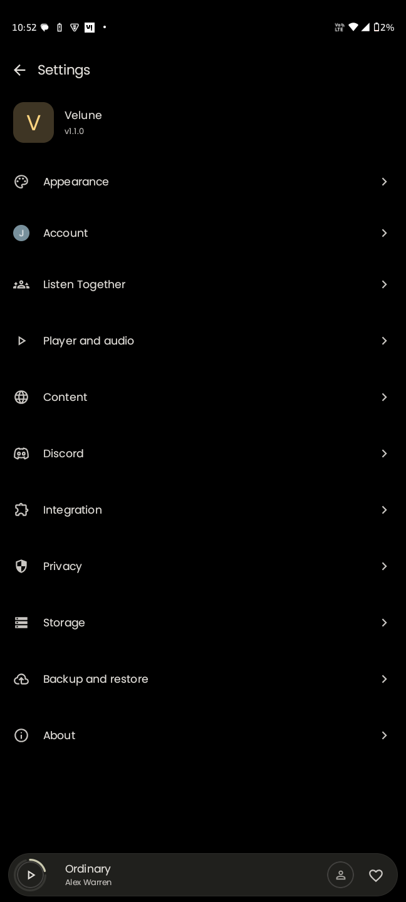
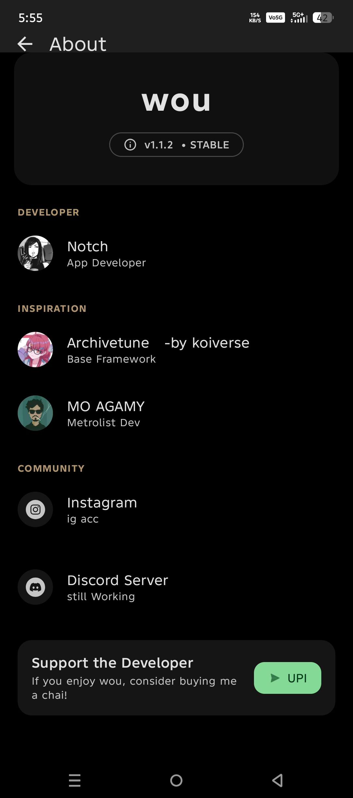

<div align="center">
  
</div>

# 🌌 WOU

<div align="center">

<pre>
__        _____  _   _ 
\ \      / / _ \| | | |
 \ \ /\ / / | | | | | |
  \ V  V /| |_| | |_| |
   \_/\_/  \___/ \___/ 
</pre>

</div>

### 🎧 The YouTube Music app you always wanted

🚫 No Ads • 💰 No Subscription • ⚡ Full Control  

## 📥 Download Now

<div align="center">

  <!-- Obtainium Button -->
  <a href="https://apps.obtainium.imranr.dev/redirect?r=obtainium://add/https://github.com/notch/WOU">
    
  </a>
  
  &nbsp;&nbsp;&nbsp;&nbsp; <!-- This adds a little space between the buttons -->

  <!-- GitHub Release Button -->
  <a href="https://github.com/notch/WOU/releases/latest">
    
  </a>

</div>

## 🚀 Why WOU?

WOU is not just another music player — it's a **complete reimagination of YouTube Music**.

* ⚡ **Faster** than the official app
* 🎵 Built for audiophiles & power users
* 📦 True offline-first experience
* 🎨 Stunning **Material You** interface

> 💡 This is YouTube Music — *but unlocked*

---

## 🎯 Highlight Feature

### 🎤 Real-Time Synced Lyrics

Experience lyrics like never before:

- Word-by-word sync  
- Smooth animations  
- Translation support  
- Fully immersive playback  

---

## 📸 Preview


<div align="center">





<br/>





</div>


## ✨ Features

### 🎵 Core Experience
- Ad-Free Playback  
- Full Library Sync  
- Offline Caching (Encrypted)  
- Background Playback  

### 🔊 Audio Engine
- Gapless Playback  
- Crossfade Engine  
- Silence Skipping  
- Loudness Normalization (EBU R128)  
- Tempo & Pitch Control  
- System EQ Integration  

### 🎨 UI & Discovery
- Material You (Dynamic Colors)  
- Synced Lyrics + Translation  
- Discord Rich Presence  
- Personalized Home Feed  
- Year in Review Stats  
- Custom Animated Loader  

---

## 🧠 Architecture

Built using **modern Android engineering principles**:

- MVVM + Clean Architecture  
- Unidirectional Data Flow (UDF)  
- Modular & scalable codebase  

---

## 🛠 Tech Stack

| Layer | Stack |
|------|------|
| Language | Kotlin |
| UI | Jetpack Compose + Material 3 |
| Audio | Media3 / ExoPlayer |
| DI | Hilt |
| Database | Room (Encrypted) |
| Networking | Ktor + Retrofit |
| Async | Coroutines + Flow |
| Build | Gradle KTS |

---

## 📂 Project Structure

```bash
wou/
├── app/
├── innertube/
├── lrclib/
├── kizzy/
├── canvas/
├── lastfm/
├── kugou/
```

Getting Started \
Requirements\
Android Studio Ladybug+\
JDK 17\
Android SDK 34+ \
Run Locally\
Bash
```
git clone https://github.com/notch/WOU.git
cd WOU
```
Open in Android Studio → Sync → Run ▶ \
📦 Download
 

🚀 Get Latest Release⁠ 

---

## 💬 Community

Have a feature request, found a bug,
or just want to share your favorite music setups? Join the official WOU community!

* *Discord:* Join the WOU Server
* *GitHub Discussions:* Open a Discussion


---


🙌 Credits\
Huge respect to these projects:

Archivetune -base framework\
Metrolist\
InnerTune\
Kizzy\
SimpMusic\
BetterLyrics

⚖️ Legal\
WOU is an independent client and is not affiliated with YouTube or Google.\
Please support artists through official platforms ❤️\
Licensed under GPL-3.0
 

💙 Built with passion by Notch\
⭐ Star the repo if WOU impressed you\
🚀 Help it reach more people

## 🔗 Star History


  https://star-history.com/notch/wou&Date">
    
      https://api.star-history.com/svg?repos=notch/wou&type=Date&theme=dark" />
      https://api.star-history.com/svg?repos=notch/wou&type=Date" />
      https://api.star-history.com/svg?repos=notch/wou&type=Date" />
