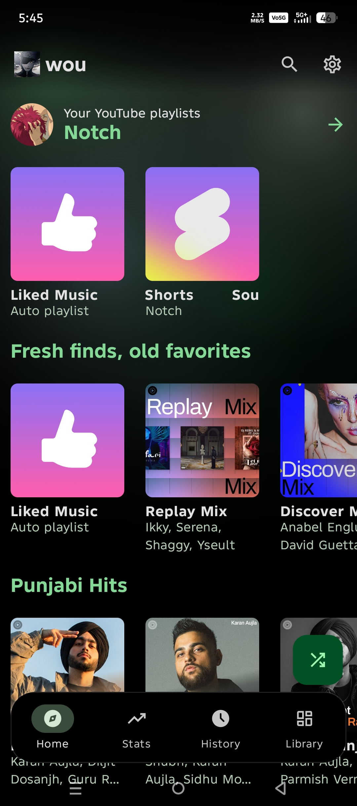
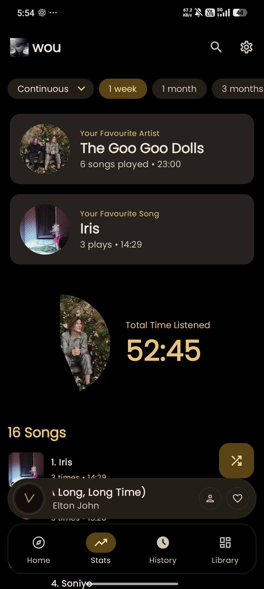

# WOU

An ad-free Android music player for YouTube Music. Built because the official app locks background playback and basic controls behind a paywall, and the interface keeps getting heavier with every release.

## Screenshots

<div align="center">
  
  
  
  
</div>

## Download

- **Releases**: Download the latest APK directly from the [GitHub Releases](https://github.com/kainotch/WOU/releases/latest) page.
- **Obtainium**: If you use [Obtainium](https://github.com/ImranR98/Obtainium) for automatic updates, add `https://github.com/kainotch/WOU` directly to track new releases.

## What it does

### Core playback
- Plays audio in the background and with the screen locked without ads or subscription prompts.
- Local caching: tracks you stream are cached locally so repeated listens don't waste bandwidth.
- Full offline downloads for individual songs, albums, and playlists.
- Optional YouTube account login to sync your library, likes, and playlists. No login required for basic streaming.

### Lyrics
- Real-time synced lyrics powered by LRCLIB and Kugou.
- Word-by-word highlight animations and live translation support.

### Audio tweaks
- Gapless playback and customizable crossfade between tracks.
- Silence skipping.
- Audio loudness normalization via EBU R128.
- System equalizer integration.

### Interface and discovery
- Clean Material You dynamic theming that adapts to your album artwork or wallpaper palette.
- Spotify-style search with quick shortcuts for Music and Podcasts, plus recent history of songs you clicked.
- Listening stats and year-in-review breakdown.

### Integrations
- Discord Rich Presence to show what you are listening to on your Discord profile.
- Last.fm scrobbling support with customizable scrobble delay and percentage triggers.

## Building from source

Requirements:
- Android Studio Ladybug or later (or command-line Android SDK)
- JDK 17
- Android SDK 34 or higher

Clone the repo and assemble the debug build:

```bash
git clone https://github.com/kainotch/WOU.git
cd WOU
./gradlew assembleDebug
```

On Windows:
```cmd
gradlew.bat assembleDebug
```

The compiled APK will be at `app/build/outputs/apk/debug/app-debug.apk`.

## Known issues

- Initial lyric fetch can take a few seconds on slower network connections, and obscure songs may only have unsynced plain text or no lyrics at all.
- YouTube occasionally changes or throttles media stream endpoints, which can cause momentary buffering hitches.
- Android Auto is not yet supported.
- Logging in to YouTube with brand accounts or complex 2FA prompts can occasionally fail on the first try and require a retry.

## Community and links

- Discord: [Join the server](https://discord.com/invite/qybFSATs7Q)
- Instagram: [@kainotch](https://www.instagram.com/kainotch/)
- GitHub Discussions: [Open a discussion](https://github.com/kainotch/WOU/discussions)
- Sponsor: [GitHub Sponsors](https://github.com/sponsors/kainotch)

## Credits and license

WOU builds on foundations created by the open-source community, particularly InnerTune, Metrolist, and Innertube. Lyrics are fetched via LRCLIB and Kugou.

Licensed under the GNU General Public License v3.0 (GPL-3.0).
